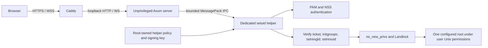

# Architecture

## Trust boundaries

The server refuses to start as UID 0. Static UI assets, configuration, audit logs
and temporary upload staging belong to the service process; managed files belong
to the helper boundary. Production authentication uses the helper rather than an
in-process mock. The `pam-auth` Cargo feature is retained for compatibility;
PAM is loaded dynamically at runtime, not gated by that feature.

The fixed `/etc/tealdrive/helper.toml` and `/etc/tealdrive/helper.key` are checked
for root ownership, non-writable parents and safe modes. The signing key is exactly
32 random bytes. No helper environment variable may override these in elevated
mode. A successful PAM/account check issues an HMAC-SHA256 ticket bound to username,
UID/GID, invoking service UID, nonce and expiry. Commands verify the ticket before
changing identity. Root identities are refused. A non-setuid developer helper may
operate only as its actual OS account; it cannot impersonate another user.

Supplementary groups are initialized from NSS before all real/effective/saved IDs
are dropped. The helper then sets `PR_SET_NO_NEW_PRIVS` and requires Landlock ABI 3.
There is no weaker fallback when the kernel sandbox cannot be installed. `openat2`
opens use `RESOLVE_BENEATH | RESOLVE_NO_SYMLINKS`. Landlock restricts path-based
operations to the selected root, including when a pathname changes after validation.
Chmod acts on an opened descriptor. Root paths and their parents must be stable,
real directories managed by the host administrator.

## Policy and operation lifecycle

Every operation uses a cloned configuration snapshot and SHA-256 revision.
The helper independently validates the snapshot. In elevated mode it intersects
permissions with its root-owned ceiling: exact root id/path match, restrictive
read-only/web-root flags, feature conjunctions, minimum limits/quotas, and combined
sensitive-file restrictions. Successful responses return the revision for client
verification. Reloading server configuration cannot widen the helper ceiling.
File policy is also checked in the server to return useful errors early.

Each WebSocket processes messages sequentially. A shared semaphore admits at most
eight authentication/filesystem jobs to blocking workers. A worker concurrently
drains helper stdout and writes stdin; deadlines cover the whole IPC exchange.
Cancellation kills and reaps the helper. IPC requests/responses are capped at 8 MiB.

Session leases monitor revocation/expiry at 250 ms intervals. Each WebSocket message
and HTTP download chunk also checks the session. Logout removes the session,
cancels its ongoing work and cleans temporary transfers. Sessions are in memory:
server restart logs everyone out. There is no multi-server session replication.

## Files and storage

HTTP downloads probe and read files in bounded 64 KiB helper ranges. Large downloads
are streamed without reading the complete file into the server. Each range starts a
helper process; this favors simple identity isolation over throughput. A file may
change between range reads; downloads are not snapshot-consistent.

Uploads are sequenced and acknowledged. The service stages chunks in a private
temporary file, verifies size and any supplied SHA-256, then sends a bounded final
commit to the helper. The default file limit is 1 MiB, with a 3 MiB configuration
maximum to leave space for MessagePack/IPC overhead. There is no upload resume.

Quota accounting acquires an exclusive `flock` on the root directory before scanning
usage and holds it through commit/rollback. This serializes cooperating helper
writers across users. Copy, save, upload, compression and extraction stage output
in the destination parent and publish with descriptor-relative `renameat2` only
on success. New destinations use `RENAME_NOREPLACE`; text save replaces atomically.
Failed outputs are removed while the quota lock is held. TAR/Gzip and ZIP finalization
errors prevent publication. ZIP/TAR traversal ignores forbidden descendants and
symlinks; extraction rejects unsafe, hidden or sensitive paths and link entries.

Quota counts logical regular-file sizes including trash. Direct OS writes do not
participate in the lock and require a filesystem quota for absolute host-wide
limits. Process kills or host crashes can leave private transaction files: publication
is atomic but automatic orphan recovery/crash durability is not implemented.

## Runtime configuration and observability

`ArcSwap` publishes validated snapshots. Partial patches preserve omitted fields.
Persistent patches serialize mutations, write a private temporary file, sync and
rename it, then publish the new in-memory configuration. Errors are reported rather
than silently ignored. File watching observes the parent directory so atomic
replacement remains visible. Watcher, admin reload and SIGHUP synchronize session
settings, helper timeout and login limiter.

The audit sink is a synchronous mutex-protected JSONL file. Login, session/WebSocket
and administrative lifecycle events are emitted; a complete per-file-operation
audit trail and asynchronous log delivery are not provided. Errors are safe client
messages, not OS path dumps. Operate audit rotation externally.
