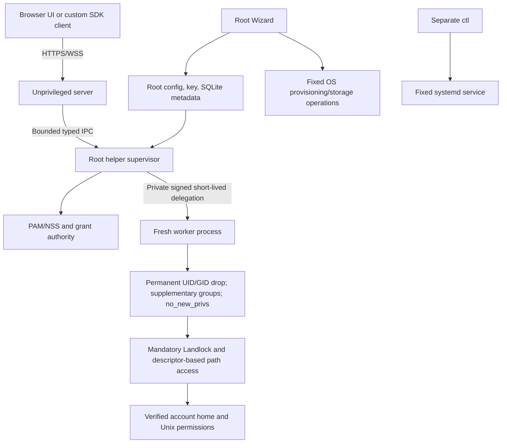

# Architecture

The application is four binaries plus embedded SDK/UI assets. Root authority and
user content handling are separated. Caddy is optional.

## Identity and authority

`/home/tealdrive/policy` and `auth/accounts.db` are Root controlled. Server reads
its public critical config and a constrained service-owned working overlay; it
cannot open the account DB or signing key. Helper verifies the kernel caller,
current NSS identity, account generation/nonce, policy and ceilings independently.
The service account is nologin and is not a panel identity.

Linux enrollment proves the OS password through PAM once and chooses an Argon2id
web password. Password/proof/grant values are not browser storage or audit data.
Grants bind to service UID, process ID/start time and boot ID. Logout revokes one
nonce; password/revoke/suspend/role/policy changes invalidate account generations.
Virtual identities have distinct locked/nologin UID/GID and web passwords; virtual
self-revoke is denied and administration is tenant scoped.

## Filesystem execution

The Root supervisor handles protected metadata/coordination and narrow management
commands. User file content and archive parsing occur only in the permanently
dropped fresh worker. Private delegation includes the operation, configuration,
caller and freshness, protected by a standard HMAC implementation. No general
shell/UID/home selector is exposed. Root DB/key handles are closed before worker
execution; the worker cannot reacquire saved Root IDs.

Worker starts single-threaded, drops identity and installs mandatory Landlock
before starting its cancellation thread. Descendants inherit restrictions.
Path access uses verified directory FDs/openat2 beneath the selected home and
rejects symlink escapes. Chmod uses a pinned descriptor, including mode000 recovery
on supported kernels. No weaker sandbox fallback is offered.

Hidden-path restrictions apply to discovery and direct API access, including
recursive/alias/trash/archive operations. Landlock confines the whole selected
home; it is not an inode secrecy system for policy-hidden entries inside that
home. External SSH/program access and arbitrary code execution do not become
subject to the helper's logical API policy. User-owned active projects can execute
modified files outside the helper; the UI warns about active writers and chmod.

## Consistency, quotas and history

Root/admin/personal rules are combined by restriction. A server snapshot cannot
turn off Root journal/lifecycle/control audit. Mutation coordination uses shared
home locks, staged writes and no-replace publication where appropriate. Read/save
revision includes content and metadata; stale writes are rejected. External
writers can still race with capture/publication, so a general transaction/snapshot
across arbitrary applications is not claimed.

SQLite stores identities, roles, allocation and protected history; file contents
remain in user homes. Virtual native UID quota includes real Root-private
user-charged ledger files. Application quota coordinates helper operations but
cannot enforce writes by outside processes. Root pool and admin reservations use
SQLite transactions; deleted identity lifecycle preserves tombstones/retired UID
fences. See QUOTA.md and STORAGE.md in intgr for the actual measurement scope.

Protected operation intents precede tracked file operations. Results preserve
success/failure/unknown truth; logging failure does not fabricate rollback. HTTP
range chunks aggregate helper-delivered bytes under one request/record/ledger.
Root control records capture auth/management/CLI intents without credential values;
central JSONL also records HTTP/security context. This is not an OS-wide audit
system, nor proof that a browser saved delivered bytes.

Undo supports move/rename/trash/chmod only when the Root record, time/epoch,
current policy and expected filesystem state still agree. Restore rotates undo
epoch and invalidates old sessions. Cleanup trusts Root tokens rather than dates
in writable trash metadata; changed/unsupported objects are preserved for review.

## Transport, SDK and shutdown

SDK uses one WS-first handshake/auth connection and a one-use HttpOnly cookie
bridge. TLS/WSS encryption and certificates are standard browser/server handling,
not custom JavaScript cryptography. The SDK renders no DOM, validates options,
exports method/event/result types and supports managed or client-owned state.
Storage contains user/origin/generation-scoped location preference, never secrets
or file contents; restored paths are helper validated.

Direct TLS and exact-origin trusted loopback TLS proxy modes are supported.
Custom UI is an immutable Root-approved manifest/package; SDK cannot be overridden,
and the embedded rescue route remains available. Package code is trusted code
that can act as the signed-in user.

Shutdown stops new admissions, drains active bodies/WS/helpers, sends a structured
notice, then cancels outstanding jobs at a bounded deadline. Helper stdin EOF
cancellation remains effective after UID drop. systemd KillMode=mixed and45s stop
deadline provide final cleanup. Browser preserves unsaved text; power loss/SIGKILL
cannot guarantee delivery of the notification or graceful completion.
